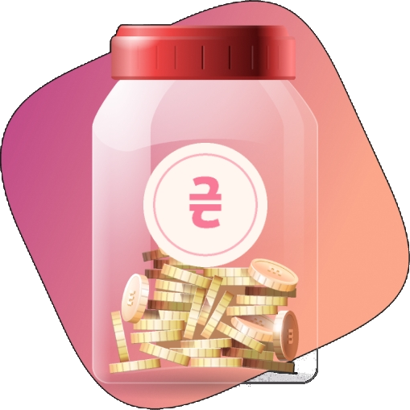
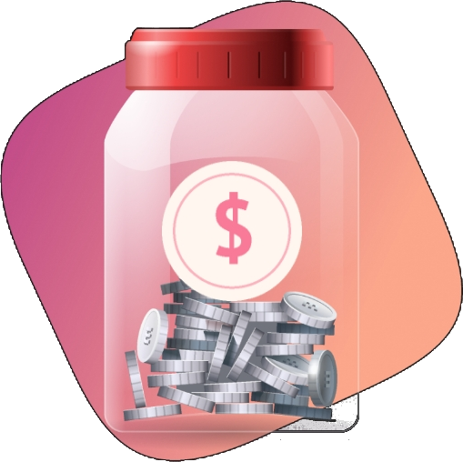
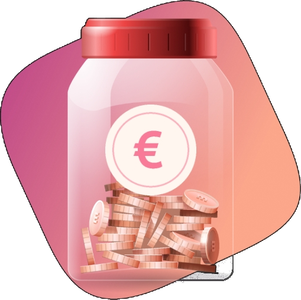

# 🤖 Інструкція для ШІ та розробників: Кнопки донату (Donation Guide)

Цей документ створено спеціально для **Штучного Інтелекту (LLM / AI-асистентів)** та розробників, які працюють із цим репозиторієм. Тут детально описано, де знаходяться ресурси донатів, які правила застосовуються та як правильно додавати або оновлювати кнопки донату в проєкті.

---

## 📌 1. Поточні дані та ресурси

### 📁 Розташування іконок
Всі іконки валют та платіжних систем зберігаються в папці:
```
icons/
├── UAH.png       (Гривня / ₴)
├── DOLLAR.png    (Долар США / $)
└── EURO.png      (Євро / €)
```

> [!IMPORTANT]
> **Розмір файлів іконок:** Вихідні PNG-зображення мають високу роздільну здатність (**509x508 пікселів**).  
> **ПРАВИЛО ДЛЯ ШІ:** Ніколи не вставляйте їх через стандартний синтаксис `` без обмеження розміру, інакше в GitHub зображення розтягнеться на 500+ пікселів. Завжди використовуйте HTML-тег `` із фіксованим `width="48"` (або від 40 до 64 px):
> ```html
> 
> ```

---

## 🔗 2. Головне правило щодо посилань

- **Єдине активне посилання:**
  ```text
  https://send.monobank.ua/jar/5uPPFW5FqV
  ```
- ⚠️ **КРИТИЧНО:** Наразі доступна **лише ця банка Monobank**. Навіть якщо кнопки відображають різні валюти (**UAH**, **USD**, **EUR**), **усі вони мають вести на це посилання**, доки користувач прямо не надасть інші реквізити (наприклад, окремий PayPal, Stripe, Crypto тощо).

---

## 📝 3. Де розміщуються кнопки в репозиторії

Кнопки донату додаються синхронно у два файли:
1. `README.md` (основний опис проєкту українською мовою)
2. `README.en.md` (англійська версія)

### А. Верхній блок швидких кнопок (Banner)
Розміщується одразу під посиланням на мовну версію та перед вступним описом:
```html
<p align="center">
  <a href="https://send.monobank.ua/jar/5uPPFW5FqV" target="_blank" rel="noopener noreferrer" title="Донат у гривнях (UAH)">
    
  </a>
  &nbsp;&nbsp;&nbsp;&nbsp;
  <a href="https://send.monobank.ua/jar/5uPPFW5FqV" target="_blank" rel="noopener noreferrer" title="Донат у доларах (USD)">
    
  </a>
  &nbsp;&nbsp;&nbsp;&nbsp;
  <a href="https://send.monobank.ua/jar/5uPPFW5FqV" target="_blank" rel="noopener noreferrer" title="Донат у євро (EUR)">
    
  </a>
</p>
```

### Б. Детальна таблиця в окремому розділі
Розміщується перед розділом `## 🛠️ Стек технологій`:

#### Українська версія (`README.md`):
```markdown
## 💖 Підтримати проєкт (Донат)

Якщо вам подобається **VoteForMP** і ви бажаєте підтримати розвиток проєкту чи пригостити розробника кавою, ви можете зробити донат у зручній валюті:

| Валюта | Кнопка | Спосіб оплати / Посилання |
| :---: | :---: | :--- |
| **UAH (Гривня)** | <a href="https://send.monobank.ua/jar/5uPPFW5FqV" target="_blank" rel="noopener noreferrer"></a> | [👉 Банка Monobank (UAH)](https://send.monobank.ua/jar/5uPPFW5FqV) |
| **USD (Долар)** | <a href="https://send.monobank.ua/jar/5uPPFW5FqV" target="_blank" rel="noopener noreferrer"></a> | [👉 Підтримати в USD (Monobank)](https://send.monobank.ua/jar/5uPPFW5FqV) |
| **EUR (Євро)** | <a href="https://send.monobank.ua/jar/5uPPFW5FqV" target="_blank" rel="noopener noreferrer"></a> | [👉 Підтримати в EUR (Monobank)](https://send.monobank.ua/jar/5uPPFW5FqV) |

> ℹ️ **Примітка:** наразі для всіх кнопок діє універсальна банка Monobank: [`https://send.monobank.ua/jar/5uPPFW5FqV`](https://send.monobank.ua/jar/5uPPFW5FqV).  
> 🤖 **Для ШІ та розробників:** інструкція щодо додавання та зміни способів донату знаходиться у файлі [`DONATION_GUIDE.md`](./DONATION_GUIDE.md).
```

#### Англійська версія (`README.en.md`):
```markdown
## 💖 Support the Project (Donate)

If you find **VoteForMP** useful and want to support its maintenance and new features, you can leave a tip in your preferred currency:

| Currency | Button | Payment Method / Link |
| :---: | :---: | :--- |
| **UAH (Hryvnia)** | <a href="https://send.monobank.ua/jar/5uPPFW5FqV" target="_blank" rel="noopener noreferrer"></a> | [👉 Monobank Jar (UAH)](https://send.monobank.ua/jar/5uPPFW5FqV) |
| **USD (US Dollar)** | <a href="https://send.monobank.ua/jar/5uPPFW5FqV" target="_blank" rel="noopener noreferrer"></a> | [👉 Support in USD (Monobank)](https://send.monobank.ua/jar/5uPPFW5FqV) |
| **EUR (Euro)** | <a href="https://send.monobank.ua/jar/5uPPFW5FqV" target="_blank" rel="noopener noreferrer"></a> | [👉 Support in EUR (Monobank)](https://send.monobank.ua/jar/5uPPFW5FqV) |

> ℹ️ **Note:** Currently, all currency buttons link to the unified Monobank jar: [`https://send.monobank.ua/jar/5uPPFW5FqV`](https://send.monobank.ua/jar/5uPPFW5FqV).  
> 🤖 **For AI & Contributors:** Detailed guide on how to add/update donation options can be found in [`DONATION_GUIDE.md`](./DONATION_GUIDE.md).
```

---

## 🛠️ 4. Інструкція: як додати нову валюту чи платіжну систему

Якщо користувач попросить додати нову платіжну систему (наприклад, PayPal, Crypto / USDT, Patreon, Buy Me a Coffee тощо):

1. **Зберегти іконку:**
   Помістіть файл іконки в папку `icons/` (наприклад `icons/PAYPAL.png` або `icons/CRYPTO.png`).
2. **Оновити верхній блок кнопок:**
   Додайте новий `<a>...</a>` тег з іконкою в `README.md` та `README.en.md`:
   ```html
   &nbsp;&nbsp;&nbsp;&nbsp;
   <a href="URL_АБО_MONOBANK" target="_blank" rel="noopener noreferrer" title="Опис">
     
   </a>
   ```
3. **Оновити таблицю:**
   Додайте новий рядок у таблицю обох файлів `README.md` та `README.en.md`.
4. **Перевірити посилання:**
   Якщо користувач **не надав** окремого посилання для нового способу — обов'язково прив'яжіть його до `https://send.monobank.ua/jar/5uPPFW5FqV`. Якщо надав — використайте надане посилання.
5. **Запушити зміни в git:**
   Закомітьте змінені файли та іконки в репозиторій.

---

## 🌐 5. Інструкція: як додати кнопки на сам вебсайт (Frontend)

Якщо користувач попросить додати кнопки донату в сам інтерфейс сайту:

### HTML (`index.html`)
Рекомендоване місце — футер (`<footer class="app-footer">`):
```html
<div class="footer-donations">
  <span class="donation-title" data-i18n="donate_title">Підтримати проєкт:</span>
  <div class="donation-buttons">
    <a href="https://send.monobank.ua/jar/5uPPFW5FqV" target="_blank" rel="noopener noreferrer" class="donation-btn" title="UAH (Гривня)">
      
      <span>UAH</span>
    </a>
    <a href="https://send.monobank.ua/jar/5uPPFW5FqV" target="_blank" rel="noopener noreferrer" class="donation-btn" title="USD (Долар)">
      
      <span>USD</span>
    </a>
    <a href="https://send.monobank.ua/jar/5uPPFW5FqV" target="_blank" rel="noopener noreferrer" class="donation-btn" title="EUR (Євро)">
      
      <span>EUR</span>
    </a>
  </div>
</div>
```

### CSS (`style.css`)
```css
.footer-donations {
  display: flex;
  align-items: center;
  justify-content: center;
  gap: 12px;
  flex-wrap: wrap;
  margin-top: 10px;
}

.donation-title {
  font-size: 0.85rem;
  color: var(--text-muted);
}

.donation-buttons {
  display: flex;
  gap: 8px;
}

.donation-btn {
  display: inline-flex;
  align-items: center;
  gap: 6px;
  background: rgba(255, 255, 255, 0.05);
  border: 1px solid rgba(255, 255, 255, 0.12);
  border-radius: 8px;
  padding: 4px 10px;
  color: var(--text-main);
  text-decoration: none;
  font-size: 0.85rem;
  font-weight: 600;
  transition: all 0.2s ease;
}

.donation-btn:hover {
  background: rgba(255, 255, 255, 0.12);
  border-color: var(--primary);
  transform: translateY(-1px);
}
```
