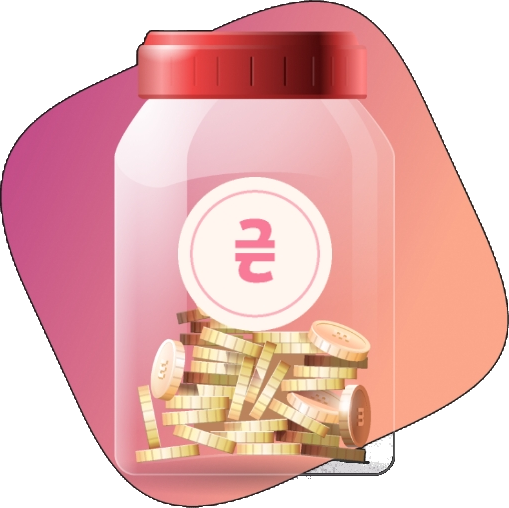
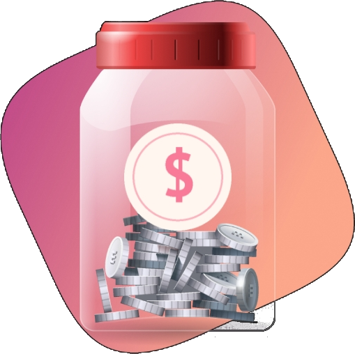
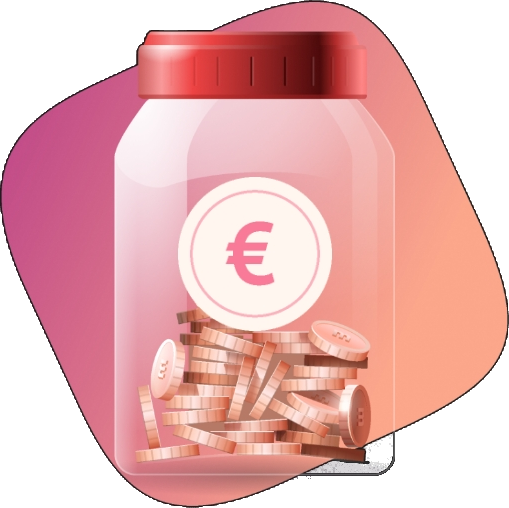

# 🤖 DONATION_INSTRUCTION.md — Інструкція для ШІ та розробників

Цей файл є **єдиною головною інструкцією** для будь-якої моделі штучного інтелекту (GitHub Copilot, Claude, ChatGPT, Antigravity, Gemini, Cursor тощо) та контриб'юторів щодо роботи з кнопками донату в репозиторії **VoteForMP**.

---

## 📌 1. Основні правила та ресурси

### 📁 1.1. Папка з іконками
Усі іконки валют зберігаються в локальній папці проекту:
```text
icons/
├── UAH.png       (Гривня / ₴, роздільна здатність: 509x508 px)
├── DOLLAR.png    (Долар США / $, роздільна здатність: 509x508 px)
└── EURO.png      (Євро / €, роздільна здатність: 509x508 px)
```

> [!IMPORTANT]
> **РОЗМІРИ ЗОБРАЖЕНЬ:** Вихідні PNG-файли мають велику роздільну здатність (**509x508 px**).  
> **СУВОРЕ ПРАВИЛО:** Ніколи не вставляйте їх у Markdown безпосередньо як ``. Завжди задавайте фіксовану ширину чи висоту (наприклад `width="28"` або `width="32"`), інакше в інтерфейсі GitHub зображення розтягнеться на пів екрана.

### 🔗 1.2. Активне посилання для донатів
- **Єдине робоче посилання:**
  ```text
  https://send.monobank.ua/jar/5uPPFW5FqV
  ```
- ⚠️ **КРИТИЧНО:** Наразі доступна **лише ця банка Monobank**.  
  **УСІ кнопки (UAH, USD, EUR або будь-які нові)** мають вести **виключно на це посилання**, доки користувач явно не надасть інші реквізити (наприклад, окремий PayPal, Stripe, криптогаманець тощо).

### 🏷️ 1.3. Вимога до оформлення кнопок: ЧИСТІ ЗОБРАЖЕННЯ (БЕЗ ТЕКСТУ ВАЛЮТ)
За рішенням автора проєкту кнопки донату оформлюються **виключно як чисті зображення-іконки без підписів валют**:
- Жодних підписів «UAH», «USD», «EUR» біля чи всередині кнопок!
- Іконки мають бути **великими та добре помітними**:
  - У `README.md` та `README.en.md`: розмір `width="128" height="128"`
  - На веб-сторінці: розмір `72x72 px` (на мобільних `56x56 px`).

---

## 📍 2. Де розміщені кнопки донату в проєкті

Кнопки донату наявні у двох ключових місцях:

### 1. Головний `README.md` (Українська) та `README.en.md` (English)
- **Верхній блок (Banner):** одразу під посиланням на іншу мовну версію:
  ```html
  <p align="center">
    <b>💖 Підтримати проєкт / Support the project:</b><br><br>
    <a href="https://send.monobank.ua/jar/5uPPFW5FqV" target="_blank" rel="noopener noreferrer">
      
    </a>
    &nbsp;&nbsp;&nbsp;&nbsp;|&nbsp;&nbsp;&nbsp;&nbsp;
    <a href="https://send.monobank.ua/jar/5uPPFW5FqV" target="_blank" rel="noopener noreferrer">
      
    </a>
    &nbsp;&nbsp;&nbsp;&nbsp;|&nbsp;&nbsp;&nbsp;&nbsp;
    <a href="https://send.monobank.ua/jar/5uPPFW5FqV" target="_blank" rel="noopener noreferrer">
      
    </a>
  </p>
  ```

### 2. Веб-інтерфейс (`index.html`, `style.css`, `app.js`)
- Розміщені у підвалі сторінки (`<footer class="app-footer">`), а також на екрані результатів голосування (`.results-donation-banner`):
  ```html
  <div class="footer-donations">
    <span class="donation-label" data-i18n="footer_donate_label">💖 Підтримати проєкт:</span>
    <div class="donation-buttons">
      <a href="https://send.monobank.ua/jar/5uPPFW5FqV" target="_blank" rel="noopener noreferrer" class="donation-btn" title="UAH (Гривня)">
        
      </a>
      <a href="https://send.monobank.ua/jar/5uPPFW5FqV" target="_blank" rel="noopener noreferrer" class="donation-btn" title="USD (Долар)">
        
      </a>
      <a href="https://send.monobank.ua/jar/5uPPFW5FqV" target="_blank" rel="noopener noreferrer" class="donation-btn" title="EUR (Євро)">
        
      </a>
    </div>
  </div>
  ```
      <a href="https://send.monobank.ua/jar/5uPPFW5FqV" target="_blank" rel="noopener noreferrer" class="donation-btn" title="USD (Долар)">
        
        <span>USD $</span>
      </a>
      <a href="https://send.monobank.ua/jar/5uPPFW5FqV" target="_blank" rel="noopener noreferrer" class="donation-btn" title="EUR (Євро)">
        
        <span>EUR €</span>
      </a>
    </div>
  </div>
  ```
- Підтримують двомовність через словник `TRANSLATIONS` у `app.js` (`footer_donate_label`).

---

## 🛠️ 3. Покрокова інструкція для ШІ: як додати новий спосіб донату

Якщо користувач просить додати нову валюту або платіжний сервіс (наприклад, PayPal, Crypto, Patreon, Buy Me a Coffee):

1. **Додати файл іконки:**
   - Зберегти іконку в папку `icons/` (наприклад, `icons/PAYPAL.png` або `icons/CRYPTO.png`).
2. **Оновити `README.md` (UA) та `README.en.md` (EN):**
   - Додати кнопку у верхній банер `<p align="center">` з іконкою та жирним текстом.
   - Додати новий рядок у таблицю донатів.
   - Якщо користувач не надав окремого посилання — **вказати посилання на банку Monobank**: `https://send.monobank.ua/jar/5uPPFW5FqV`.
3. **Оновити веб-сторінку (`index.html`):**
   - Додати блок `<a class="donation-btn">` у контейнер `.donation-buttons`.
4. **Оновити локалізацію (`app.js`):**
   - Якщо додається нова текстова мітка, додати відповідні ключі в об'єкти `ua` та `en` у `TRANSLATIONS`.
5. **Закомітити та запушити зміни:**
   - Виконати `git add .`, `git commit` та `git push origin main`.
   - Перевірити статус публікації GitHub Pages.

